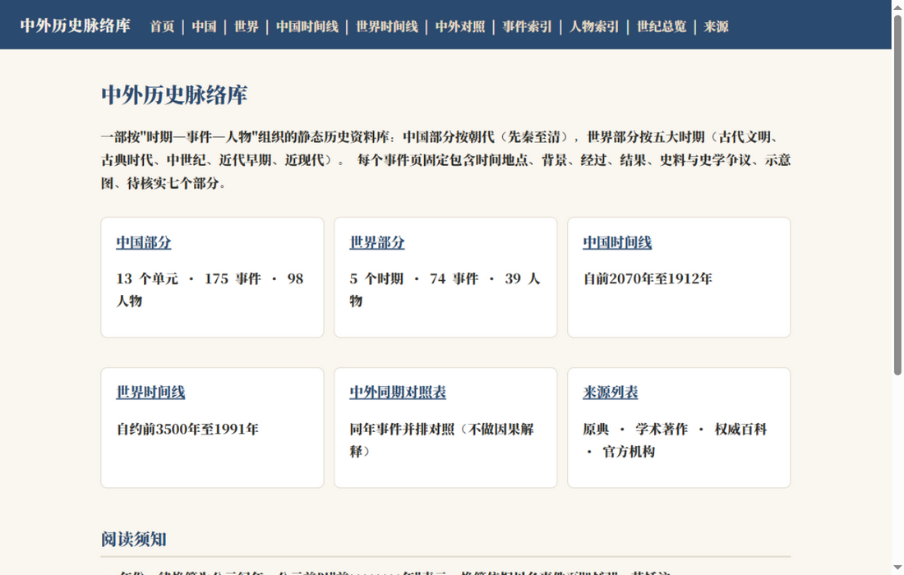
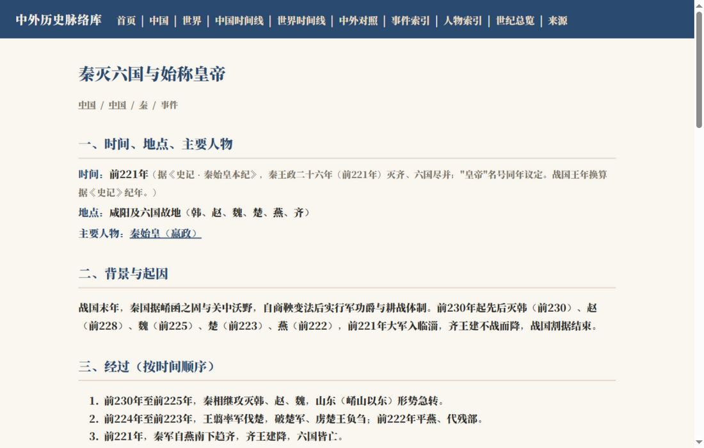
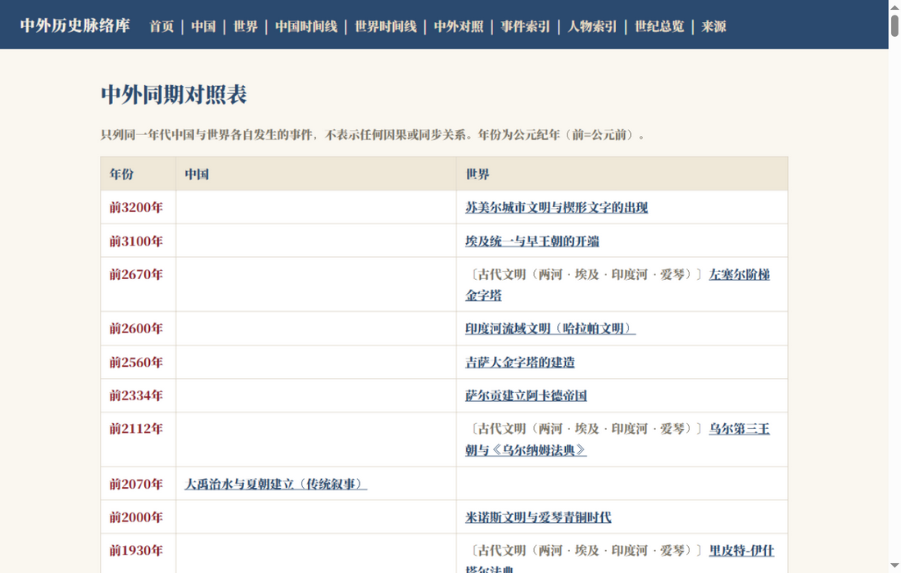
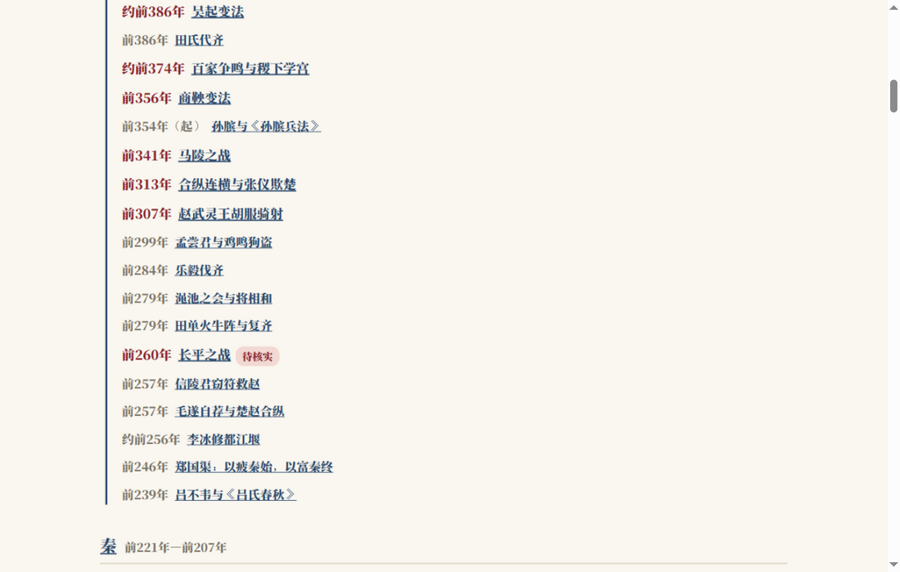
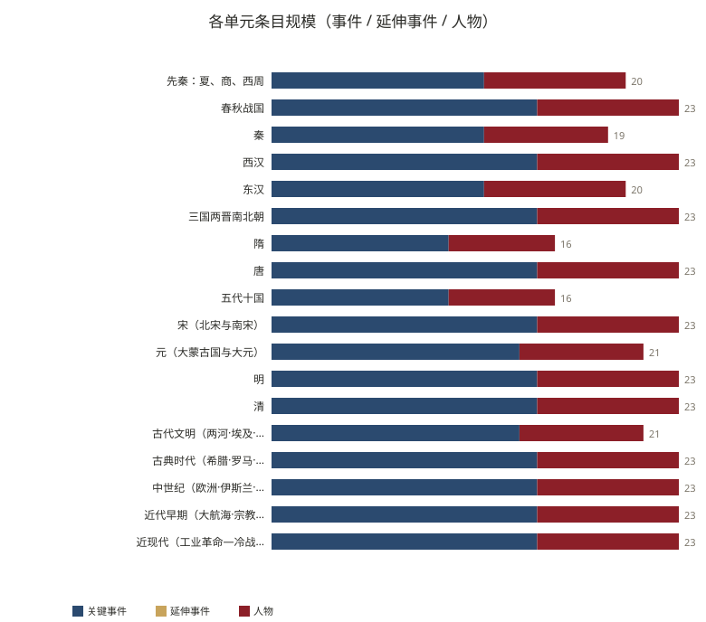
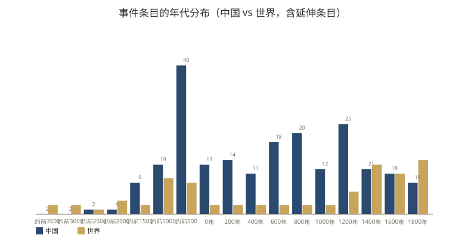
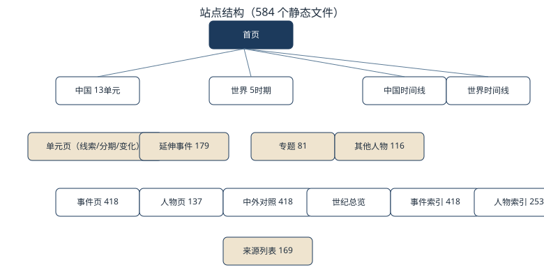

# 镜花水月 · 中外历史脉络库

> 一部按「时期 → 事件 → 人物」组织的中国史与世界史双库静态资料站，纯 HTML+CSS，零 JS 依赖，可离线浏览。
> 历史，即镜花水月——看得见，摸不着。

**在线站点：[https://tiandihuang.github.io/history/](https://tiandihuang.github.io/history/)**（Pages 已启用，每次 push 自动部署）

## 首页预览



## 它是什么

- **中国部分**：先秦 → 清，13 个单元（夏商西周 / 春秋战国 / 秦 / 西汉 / 东汉 / 三国两晋南北朝 / 隋 / 唐 / 五代十国 / 宋 / 元 / 明 / 清）
- **世界部分**：5 大时期（古代文明 / 古典时代 / 中世纪 / 近代早期 / 近现代）
- **每个关键事件页固定七节**：时间地点人物 → 背景起因 → 经过 → 结果影响 → **史料与史学争议** → 示意图 → **待核实**
- **每个事件都有一张内联 SVG 示意图**（流程图或地图式示意）
- **诚实标注体系**：关键事实须两个独立来源印证，不足一律标注「待核实」并列明缺口；争议条目并列各方说法，不代读者下结论

### 事件详情页示例



### 中外同期对照表（只并列，不做因果解释）



### 中国时间线（关键事件可点入，延伸条目灰色并序）



## 数据规模

| 项目 | 数量 |
|---|---|
| 事件条目（关键 249 + 延伸 169，全部有详情页） | **418** |
| 人物条目（主 137 + 其他 116） | **253** |
| 专题论述（经济社会/技术/宗教艺术等） | **81** |
| 史学争议条目 | **322+** |
| SVG 示意图 | **249** |
| 来源（原典/学术著作/权威百科/官方机构） | **169** |
| 站点静态文件 | **584** |

### 各单元条目规模



### 事件条目的年代分布



### 站点结构



## 板块一览

| 板块 | 内容 |
|---|---|
| 单元总览页 ×18 | 线索 · 分期 · 重要变化 · 关键事件 · 延伸事件 · 专题 · 关键人物 · 其他人物 |
| 事件详情页 ×418 | 关键事件（七节+示意图）与延伸事件（轻量页） |
| 人物页 ×137 | 生卒年 · 年谱 · 主要事迹 · 相关事件 · 评价分歧 |
| 时间线 ×2 | 中国 254 条 · 世界 105 条，全部可点入详情 |
| 中外对照表 | 418 条按公元纪年并排（仅并列，不做因果解释） |
| 世纪总览 | 前 31 世纪 → 20 世纪，按世纪粒度汇总 |
| 关系图谱 | 1 张全站单元网络 + 18 张「事件×人物」二部关联图，节点可点击、悬停显示详情（纯 SVG 零 JS） |
| 事件索引 | 418 条按公元纪年全站排序 |
| 人物索引 | 253 位按出生年全站排序 |
| 来源列表 | 169 条，三态链接核验（可达/反爬拦截/离线） |

## 快速开始

```bash
python tools/check.py      # 数据校验（0 errors 为发布门槛）
python tools/gen_site.py   # 生成 site/ 静态站点
python tools/check_links.py  # 站内链接完整性核验（0 断链为发布门槛）
python -m http.server 8000 --directory site   # 本地浏览 → http://127.0.0.1:8000
python tools/linkcheck.py  # 可选：核验来源外部链接
python tools/gen_readme_images.py  # 可选：重新生成 README 统计图
```

## 目录结构

```
history/
├─ scope.md               18 个单元的入选清单（定稿）
├─ sources.json           169 条来源
├─ data/china/*.json      中国 13 单元
├─ data/world/*.json      世界 5 单元
├─ data/enrich/*.json     延伸事件与其他重要人物
├─ data/themes/*.json     单元专题论述
├─ tools/                 check.py / gen_site.py / check_links.py / linkcheck.py / fix_quotes.py / gen_readme_images.py
├─ site/                  生成的静态站点（即 Pages 部署物）
├─ assets/img/            README 可视化图片
├─ .github/workflows/     GitHub Pages 自动部署
├─ REPORT.md              交付报告（v1.0–v1.4 迭代记录）
├─ DECISIONS.md           无人值守决策记录
└─ BLOCKERS.md            空（无阻断）
```

## 数据规范（由 tools/check.py 强制）

- 年份用整数（负数=公元前），显示文本与数值必须一致
- 每事件页固定七节；每事件 ≥1 张 SVG（XML 合法、白名单元素、无脚本）
- **双源规则**：关键事实需两个独立来源；不足必须「待核实」并写明缺口
- 古代纪年换算（干支/帝号/王年→公元）须写明依据
- 争议并列各方说法与史料依据；数字类事实必须括注来源，单源数字一律移入待核实
- 年代学争议（如武王克商三说、夏商周断代工程）均如实并列，不取单一结论
- 条目 id 仅允许小写字母、数字与连字符（R16），保证链接与文件名安全

## 来源

169 条来源分四类：**史料原典**（中国哲学书电子化计划、维基文库、Perseus、Fordham Sourcebook、Gutenberg）、**学术著作**（剑桥中国史/古代史/中世纪史，钱穆、吕思勉、陈寅恪、田余庆、Hobsbawm 等）、**权威百科**（Britannica、Wikipedia、中国大百科）、**官方机构**（UNESCO WHC、故宫、国博、社科院考古所等）。链接经三态核验：可达 / 反爬拦截（服务器拒绝脚本，URL 有效）/ 离线文献。

## 免责声明

本站为静态资料库，内容仅供学习参考，不构成学术结论；引用请核对原始文献。条目中标注「待核实」的内容请勿直接引用。
